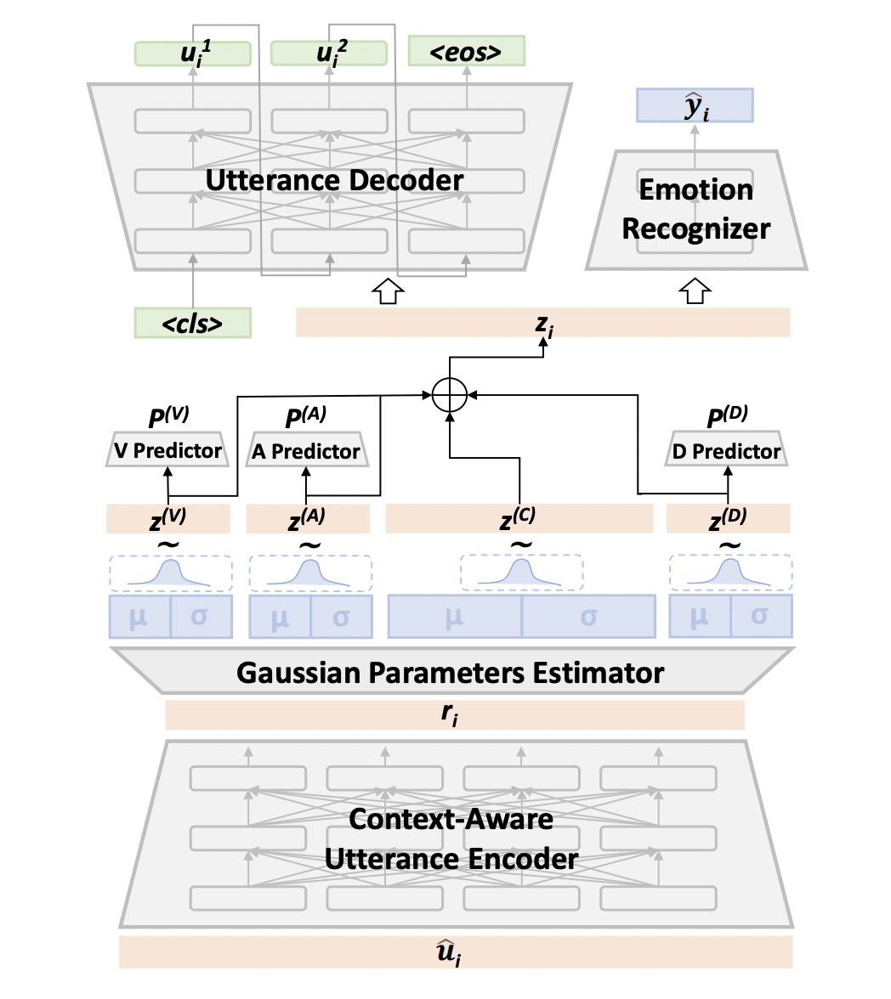

# Emotion Recognition in Conversations with Disentangled VAD-VAE

A deep learning framework for Emotion Recognition in Conversations (ERC). This project introduces a disentangled Variational Autoencoder (VAE) guided by psychological Valence-Arousal-Dominance (VAD) affective dimensions to separate emotional cues from conversational semantic content.

---

## Overview

Recognizing emotions in multi-turn conversations is challenging because conversational utterances contain both semantic dialogue context (what is being talked about) and emotional signals (how the speaker feels). Traditional models often entangle these two aspects, leading to noisy representations and lower generalization.

This project addresses this challenge by disentangling the latent representation into:
1. **Emotional Dimensions (VAD)**: Valence (positivity/negativity), Arousal (calmness/excitation), and Dominance (submissiveness/control).
2. **Semantic Content Dimension**: The topic and factual conversation context independent of emotion.

By using mutual information minimization (vCLUB) and utterance reconstruction with a pretrained BART decoder, the model ensures that emotional features and semantic content are cleanly separated and fully preserved, boosting emotion classification performance across benchmark dialogue datasets.

---

## Model Architecture



The framework consists of five main building blocks:

```
[ Dialogue History + Current Utterance ]
                 |
                 v
     [ Context Encoder: RoBERTa ]
                 |
                 v
   [ Hidden Dialogue Representation ]
                 |
         +-------+-------+
         |               |
         v               v
  [ VAD Latent Space ] [ Content Latent Space ]
   (Valence, Arousal,      (Semantic Context)
       Dominance)
         |               |
         +-------+-------+
                 |
                 +-----> [ Mutual Information Minimization (vCLUB) ]
                 |       (Ensures independence between V, A, D, and Content)
                 |
                 +-----> [ VAD Supervision (NRC-VAD Lexicon Regression) ]
                 |
                 +-----> [ Utterance Reconstruction: BART Decoder ]
                 |       (Prevents information loss)
                 |
                 v
      [ Emotion Classifier Head ]
                 |
                 v
      [ Predicted Emotion Class ]
```

### 1. Dialogue Context Encoder (RoBERTa)
The model takes the dialogue history and the target utterance as input, tokenized with RoBERTa. The pretrained RoBERTa encoder captures sequential context and speaker dynamics into a dense contextual vector.

### 2. Disentangled Latent Spaces
The hidden representation from RoBERTa is mapped into separate latent spaces:
- **Valence Space ($z_V$)**: Measures positive vs. negative sentiment.
- **Arousal Space ($z_A$)**: Measures passive vs. active intensity.
- **Dominance Space ($z_D$)**: Measures submissive vs. dominant attitude.
- **Content Space ($z_C$)**: Captures the factual conversation context independent of emotional tone.

Each latent space is modeled as a Gaussian distribution with learned mean ($\mu$) and log-variance ($\log \sigma^2$) parameters using the standard VAE reparameterization trick:
$$z = \mu + \epsilon \odot \exp(0.5 \cdot \log \sigma^2), \quad \epsilon \sim \mathcal{N}(0, I)$$

### 3. VAD Lexical Supervision
To give the latent dimensions clear physical and psychological meaning, the model predicts continuous Valence, Arousal, and Dominance scores supervised by the NRC-VAD lexicon using Mean Squared Error (MSE) loss.

### 4. Mutual Information Minimization (vCLUB)
To make sure the latent variables do not encode overlapping information, the model minimizes the mutual information between each pair of latent representations using the Variational Contrastive Log-ratio Upper Bound (vCLUB). This enforces true disentanglement between emotional dimensions and conversational content.

### 5. Utterance Reconstruction (BART Decoder)
The latent variables are concatenated and fed into a pretrained BART decoder to reconstruct the target utterance. This language modeling objective ensures that semantic information is not lost during the latent projection.

### 6. Emotion Classification Head
The disentangled emotional representations are passed to a classification head with linear layers, tanh activation, and dropout to predict the discrete emotion class (e.g., Happy, Sad, Angry, Neutral).

---

## Supported Datasets

The repository supports standard conversational emotion recognition benchmark datasets:

| Dataset | Dialogue Source | Number of Emotion Classes | Emotion Labels |
|---|---|---|---|
| IEMOCAP | Two-actor recorded scripted and improvised dialogues | 6 | Happy, Sad, Neutral, Angry, Excited, Frustrated |
| MELD | Multi-party TV show conversations (Friends) | 7 | Neutral, Surprise, Fear, Sadness, Joy, Disgust, Anger |
| DailyDialog | Daily human life communication dialogues | 7 | No emotion, Anger, Disgust, Fear, Happiness, Sadness, Surprise |
| EmoryNLP | TV show scripts (Friends) with emotion annotations | 7 | Neutral, Joyful, Peaceful, Powerful, Scared, Mad, Sad |

---

## Project Structure

```
Emotion-Recognition-in-Conversations/
|-- data/                     # Directory for dataset files (JSON and pickle)
|-- figs/
|   `-- teaser.png            # Model architecture diagram
|-- NRC-VAD/
|   `-- NRC-VAD-Lexicon.txt   # NRC Valence, Arousal, and Dominance Lexicon
|-- latent_save_dir/          # Output directory for saving latent representations
|-- model_save_dir/           # Output directory for saving trained model checkpoints
|-- pytorch_transformers/     # Custom transformer configurations and adapter modules
|-- utils/
|   |-- utils.py              # Dataset loaders, metrics, and evaluation helpers
|   `-- NRC-VAD-Lexicon.txt   # Lexicon copy for utility lookup
|-- vae/
|   |-- data_utils.py         # Batching and data processing for VAE
|   |-- losses.py             # CLUB mutual information and KL divergence losses
|   |-- model.py              # Base VAE components
|   `-- utils.py              # Latent sampling and helper functions
|-- .gitignore                # Git ignore rules
|-- data.py                   # Data inspection and tokenization utilities
|-- loss.py                   # Custom loss functions (EMD, SupCon)
|-- main.py                   # Main training and evaluation entry point
|-- model.py                  # Core VAD-VAE and baseline model definitions
|-- modeling_bart.py          # Custom BART architecture with cross-attention
|-- requirements.txt          # Python dependencies
|-- visualisation.py          # Latent space visualization script
`-- README.md                 # Project documentation
```

---

## Getting Started

### 1. Environment Setup

Create and activate a Python 3.7 or newer virtual environment:

```bash
conda create -n erc python=3.7 -y
conda activate erc
```

Install the required packages:

```bash
pip install -r requirements.txt
```

### 2. Download Preprocessed Data

Download the preprocessed dataset bundle from Google Drive:
- [Download Data Archive](https://drive.google.com/file/d/1HqgroEAvfZcGplBbtxOzhko2-iyYbr9s/view?usp=sharing)

Extract the downloaded files into the `data/` folder so the layout matches:

```
data/
|-- IEMOCAP/
|   |-- train_data.json
|   |-- dev_data.json
|   |-- test_data.json
|   |-- label_vocab.pkl
|   `-- speaker_vocab.pkl
|-- MELD/
|   |-- train_data.json
|   |-- dev_data.json
|   |-- test_data.json
|   |-- label_vocab.pkl
|   `-- speaker_vocab.pkl
`-- DailyDialog/
    |-- train_data.json
    |-- dev_data.json
    |-- test_data.json
    |-- label_vocab.pkl
    `-- speaker_vocab.pkl
```

---

## Training and Evaluation

All experiments are executed through `main.py`.

### IEMOCAP Dataset

Train on IEMOCAP:
```bash
python main.py \
    --DATASET IEMOCAP \
    --model_checkpoint roberta-large \
    --bart_model_checkpoint facebook/bart-large \
    --alpha 0.8 \
    --NUM_TRAIN_EPOCHS 5 \
    --BATCH_SIZE 4 \
    --kl_weight 0.001 \
    --model_save_dir ./model_save_dir/IEMOCAP \
    --mode train \
    --SEED 42 \
    --CUDA \
    --mi_loss
```

Evaluate on IEMOCAP:
```bash
python main.py \
    --DATASET IEMOCAP \
    --model_checkpoint roberta-large \
    --bart_model_checkpoint facebook/bart-large \
    --alpha 0.8 \
    --BATCH_SIZE 4 \
    --kl_weight 0.001 \
    --mode eval \
    --model_load_path ./model_save_dir/IEMOCAP/model_state_dict_2.pth \
    --SEED 42 \
    --CUDA \
    --mi_loss
```

---

### MELD Dataset

Train on MELD:
```bash
python main.py \
    --DATASET MELD \
    --model_checkpoint roberta-large \
    --bart_model_checkpoint facebook/bart-large \
    --alpha 0.8 \
    --NUM_TRAIN_EPOCHS 5 \
    --BATCH_SIZE 4 \
    --kl_weight 0.001 \
    --model_save_dir ./model_save_dir/MELD \
    --mode train \
    --SEED 2 \
    --CUDA
```

Evaluate on MELD:
```bash
python main.py \
    --DATASET MELD \
    --model_checkpoint roberta-large \
    --bart_model_checkpoint facebook/bart-large \
    --alpha 0.8 \
    --BATCH_SIZE 4 \
    --kl_weight 0.001 \
    --mode eval \
    --model_load_path ./model_save_dir/MELD/model_state_dict_4.pth \
    --SEED 42 \
    --CUDA
```

---

### DailyDialog Dataset

Train on DailyDialog:
```bash
python main.py \
    --DATASET DailyDialog \
    --model_checkpoint roberta-large \
    --bart_model_checkpoint facebook/bart-large \
    --alpha 0.8 \
    --NUM_TRAIN_EPOCHS 5 \
    --BATCH_SIZE 16 \
    --kl_weight 0.001 \
    --model_save_dir ./model_save_dir/DailyDialog \
    --mode train \
    --SEED 42 \
    --CUDA \
    --mi_loss
```

Evaluate on DailyDialog:
```bash
python main.py \
    --DATASET DailyDialog \
    --model_checkpoint roberta-large \
    --bart_model_checkpoint facebook/bart-large \
    --alpha 0.8 \
    --BATCH_SIZE 16 \
    --kl_weight 0.001 \
    --mode eval \
    --model_load_path ./model_save_dir/DailyDialog/model_state_dict_3.pth \
    --SEED 42 \
    --CUDA \
    --mi_loss
```

---

## Key Arguments Reference

| Argument | Type | Default | Description |
|---|---|---|---|
| `--DATASET` | str | IEMOCAP | Dataset name (IEMOCAP, MELD, DailyDialog, EmoryNLP) |
| `--model_checkpoint` | str | roberta-large | Pretrained checkpoint used as dialogue context encoder |
| `--bart_model_checkpoint` | str | facebook/bart-large | Pretrained checkpoint used as utterance reconstruction decoder |
| `--mode` | str | train | Execution mode (`train` or `eval`) |
| `--NUM_TRAIN_EPOCHS` | int | 5 | Total training epochs |
| `--BATCH_SIZE` | int | 4 | Batch size for training and evaluation |
| `--LR` | float | 1e-5 | Learning rate for optimizer |
| `--alpha` | float | 0.8 | Weight factor balancing reconstruction and emotion classification |
| `--kl_weight` | float | 0.001 | Weight multiplier for KL divergence loss |
| `--mi_loss` | flag | False | Enables CLUB mutual information loss for latent disentanglement |
| `--mi_loss_weight` | float | 0.05 | Weight for mutual information loss |
| `--SEED` | int | 42 | Random seed for reproducibility |
| `--CUDA` | flag | False | Enable GPU acceleration |
| `--model_save_dir` | str | - | Path where trained model checkpoints are stored |
| `--model_load_path` | str | - | Path to a specific checkpoint for evaluation |

---

## Evaluation Metrics

Evaluation computes standard classification metrics for dialogue emotion recognition:
- **Weighted F1 Score**: Measures overall precision and recall accounting for class imbalance.
- **Macro F1 Score**: Calculates unweighted average F1 across all classes.
- **Accuracy and Confusion Matrix**: Inspects specific misclassification patterns across classes.
